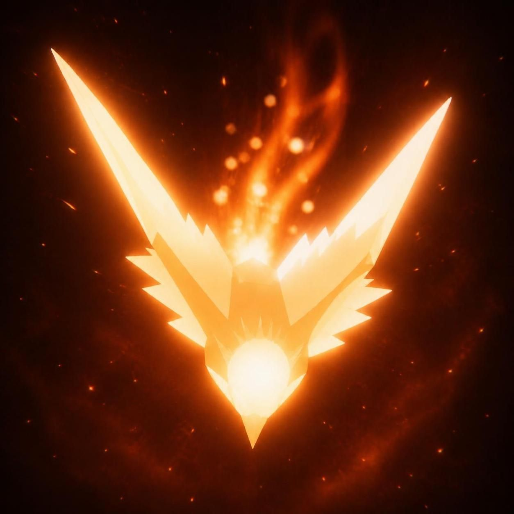

# Inferno Wings



A one-button 3D arcade flyer. You are a phoenix tearing through a volcanic hellscape full of obsidian spires, fire-spitting dragons and ancient boss wyrms, with explosions, slow-mo, bloom and a synthesized metal soundtrack. Solo, or co-op with a friend on the same keyboard or the same phone.

Built with [three.js](https://threejs.org/). Every sound and every note of music is generated live with the Web Audio API, so there are no audio files at all.

## Play

All builds are on the [**Releases**](https://github.com/minuus69/inferno-bird/releases) page. You can also build them yourself, see [Building](#building).

### Standalone apps (recommended)

Real desktop apps with their own window, icon and bundled browser engine, so nothing else needs to be installed:

| System | File |
|---|---|
| Windows x86_64, installer (Start menu + desktop shortcut, uninstaller) | `inferno-wings-windows-setup.exe` |
| Windows x86_64, portable (single file, no install) | `inferno-wings-windows-portable.exe` |
| Linux x86_64 | `inferno-wings-linux-x86_64.AppImage` |
| Linux ARM64 (Raspberry Pi 4/5, ARM laptops…) | `inferno-wings-linux-arm64.AppImage` |
| Android 5.0+ phones & tablets (any CPU) | `inferno-wings-android.apk` |

**Windows**: run the installer, or just double-click the portable `.exe`. They aren't code-signed, so SmartScreen may warn you: click *More info → Run anyway*.

**Linux**:

```bash
chmod +x inferno-wings-linux-x86_64.AppImage
./inferno-wings-linux-x86_64.AppImage
```

AppImages need FUSE 2 (`libfuse2`), which most desktop distros ship. Without it, run it with `--appimage-extract-and-run`.

`F11` (or `Alt+Enter`) toggles fullscreen in the desktop apps.

**Android**: copy `inferno-wings-android.apk` to the phone and open it. Android will ask you to allow installs from that app (your browser or file manager) the first time. The game runs full screen in portrait or landscape. Landscape is nicer for co-op. It needs an up-to-date *Android System WebView* (Chrome 89+), which every phone on Play Store updates already has.

### Lightweight launchers (~7 MB)

If you'd rather not download 100 MB, these tiny executables do the same job using a browser that's already on the computer:

| System | File |
|---|---|
| Linux x86_64 | `inferno-wings-linux-x86_64` |
| Linux ARM64 | `inferno-wings-linux-arm64` |
| Windows x86_64 | `inferno-wings-windows-x86_64.exe` |

Each one serves the game locally and opens it in Chrome, Edge, Chromium, Brave or Vivaldi in app mode (a window without browser bars). Windows always has Edge, so this just works there. If no Chromium-based browser is found, the game opens in your default browser instead. Closing the window quits the launcher.

Each release includes a `SHA256SUMS` file with checksums for every build.

### Without the executable

The game is a plain static web page in [`game/`](game). Serve that folder and open it in a browser:

```bash
python3 -m http.server 8000 --directory game
# then open http://localhost:8000
```

Everything is bundled locally (three.js, fonts), so it works offline.

## How to play

| Key | What it does |
|---|---|
| `Space` | Flap. Every flap also spits a homing fireball. |
| hold `Space` (fury bar full) | Hold for 1 second to unleash **Inferno**. Time slows down while you charge. |
| `Enter` / `Numpad Enter` | On the title screen: start **co-op**. In co-op: Player 2 flaps. |
| `Esc` | On the death screen: back to the main menu. |

### Touch (Android, tablets, phones)

| Touch | What it does |
|---|---|
| Tap anywhere | Flap (on the title screen: start solo). |
| Two fingers at once on the title screen | Start **co-op**: the left half of the screen is the orange bird, the right half the blue one. Both halves light up in their colour for a second when the run starts. |
| Hold a finger down (fury bar full) | Hold for 1 second to unleash **Inferno**. In co-op either side works. |
| Death screen: tap / hold 1 second | Try again / back to the main menu. |
| Android back button | Back to the main menu; on the main menu it closes the game. |

- **Pillars**: fly through the gaps. Skimming one gives you a *close call*: +1 point and some fury.
- **Soul shards** (blue crystals): points and fury.
- **Dragons** show up and spit fire at you. Their mouths glow right before they shoot. Your fireballs home in on them and can also shoot down incoming fire.
- **Boss wyrms** rise out of the lava every so often with a health bar, fireball volleys, walls of fire and a sweeping flame breath. They get enraged at half health.
- **Inferno**: fill the fury bar, then hold your flap key for a second. You get double damage, triple auto-fire, and **one extra life** (a glowing shield). You're not invincible: the second hit still kills you.

### Graphics quality

The title screen has a **GRAPHICS** switch (click/tap it, or press `G`). The choice is saved per device.

| Preset | What it does |
|---|---|
| **ULTRA** | The full look: up to 1.5× resolution on high-DPI screens, bloom, film grain/vignette, all particles, 6 explosion lights. |
| **MID** | Native resolution (1×), bloom kept, ~60% of the particles, lighter lava/sky shaders, 3 explosion lights. |
| **POTATO** | ~0.65× resolution, no post-processing, ~35% of the particles, simplest shaders, no explosion lights, no pillar spikes, thicker fog with a shorter draw distance. |

Add `?fps` to the URL to show a frame-rate counter.

### Co-op

Two phoenixes on one keyboard: orange **P1 on Space**, blue **P2 on Enter**.

- **Split sections**: each pillar has two gaps. The **blue** gap at the bottom is P2's lane and the **orange** gap at the top is P1's. Each lane has its own souls. Both of you going through your own lane gives an **IN SYNC** bonus.
- **Together sections**: one wide **gold** gap that both birds have to squeeze through.
- If one of you goes down, they're back in 8 seconds. Every soul shard grabbed cuts 2 seconds off that. The run only ends when both of you are down at the same time.
- The fury bar is shared, and either player can hold to trigger Inferno. Both birds get the shield.

Solo and co-op best scores are saved separately.

## Launcher options

```
--browser      open in the default browser instead of an app window
--no-window    only run the local server and print the URL
--port N       port to serve on (default 47823; a free one is picked if busy)
```

The app window keeps its own browser profile (in your user config dir under `inferno-wings/`), so best scores survive restarts.

## Building

### Standalone desktop apps (Electron)

```bash
./build-electron.sh
```

Needs Node.js 18+ and npm. It builds both Linux AppImages and the Windows portable `.exe` and installer into `dist/`. The Windows installer step uses Wine when you build on Linux; set `SKIP_WIN_INSTALLER=1` if you don't have it. The app itself is [`electron/main.js`](electron/main.js): one window that serves `game/` from a private `app://` origin. No local server or open port is involved, and best scores and the graphics preset are saved like in a browser.

### Android APK

```bash
./build-apk.sh
```

No Gradle or Android Studio needed. It uses a JDK 17+ and the Android SDK (`build-tools;35.0.0` and `platforms;android-35`, looked up in `$ANDROID_HOME` or `~/Android/Sdk`). The app is a small Java WebView wrapper ([`android/`](android)) with `game/` packed into its assets, so it runs fully offline and has no network permission. It has no native code, so one APK covers arm64, 32-bit ARM, x86 and x86_64 devices.

The first build creates a signing key at `android/inferno-wings.keystore` (password `infernowings`, override with `KEYSTORE` / `KS_PASS`). **Keep that file**: Android only installs an update over an existing install when it's signed with the same key. Set `VERSION_CODE` / `VERSION_NAME` to bump the version.

### Desktop

The Windows icon comes from `rsrc_windows_amd64.syso`. After changing `icon.png`, regenerate it with `python3 tools/winicon.py`. The Android launcher icons in `android/res/mipmap-*` and `game/icon-192.png` are also made from `icon.png`.

You only need [Go](https://go.dev/dl/) 1.22 or newer. The launcher is pure Go with no cgo, so all three targets cross-compile from any OS:

```bash
./build.sh
```

That writes the three executables plus `SHA256SUMS` to `dist/`. The whole `game/` folder is embedded into each binary with `go:embed`. The launcher serves it on `127.0.0.1` and opens the window.

## Project layout

```
game/                 the actual game
  index.html          all game code: rendering, gameplay, audio, UI
  vendor/three/       three.js r160 + the post-processing addons it uses (MIT)
  vendor/fonts/       Metal Mania + Russo One (SIL Open Font License)
electron/             standalone desktop app (Electron): main.js, package.json, icons
build-electron.sh     builds the Electron apps
main.go               lightweight launcher: embeds game/, serves it, opens a browser app window
build.sh              cross-compile script (desktop)
build-apk.sh          Android APK build script
icon.png              app icon source (Android launcher, Windows .exe, favicon)
rsrc_windows_amd64.syso  Windows icon resource, generated by tools/winicon.py
tools/winicon.py      turns icon.png into the .syso (needs Python + Pillow)
android/              Android WebView wrapper: manifest, MainActivity.java, launcher icon
dist/                 build output (not in git; builds are published as release assets)
```

## License

Inferno Wings is released under the GNU General Public License v3.0, see [`LICENSE`](LICENSE).

## Credits & third-party licenses

- [three.js](https://github.com/mrdoob/three.js) r160, MIT License, see [`game/vendor/three/LICENSE`](game/vendor/three/LICENSE).
- [Metal Mania](https://fonts.google.com/specimen/Metal+Mania) by Open Window and [Russo One](https://fonts.google.com/specimen/Russo+One) by Jovanny Lemonad, both under the SIL Open Font License 1.1, see [`game/vendor/fonts/`](game/vendor/fonts).
